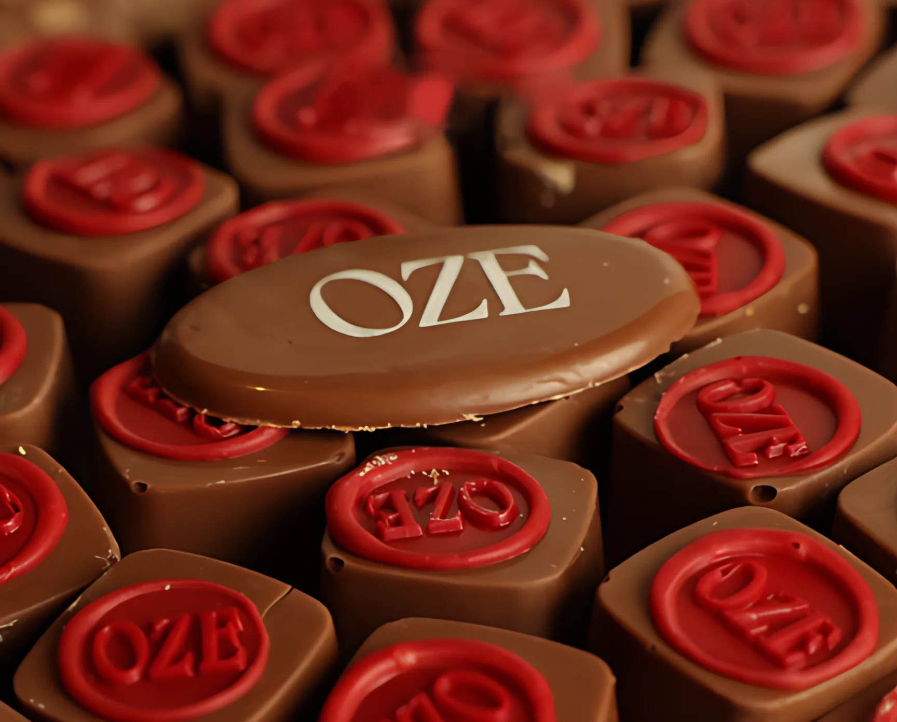
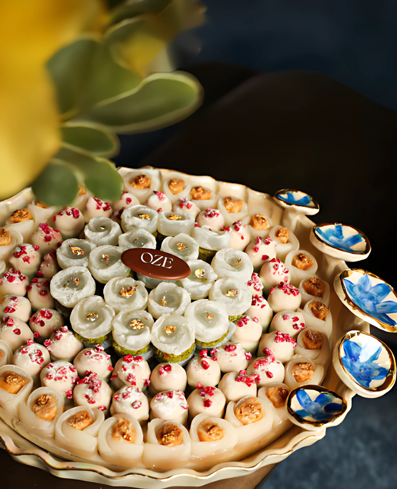
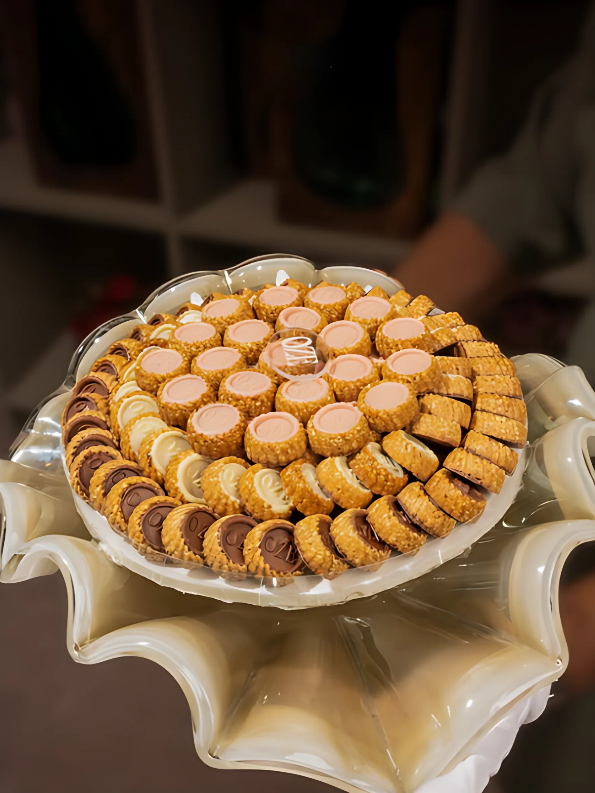
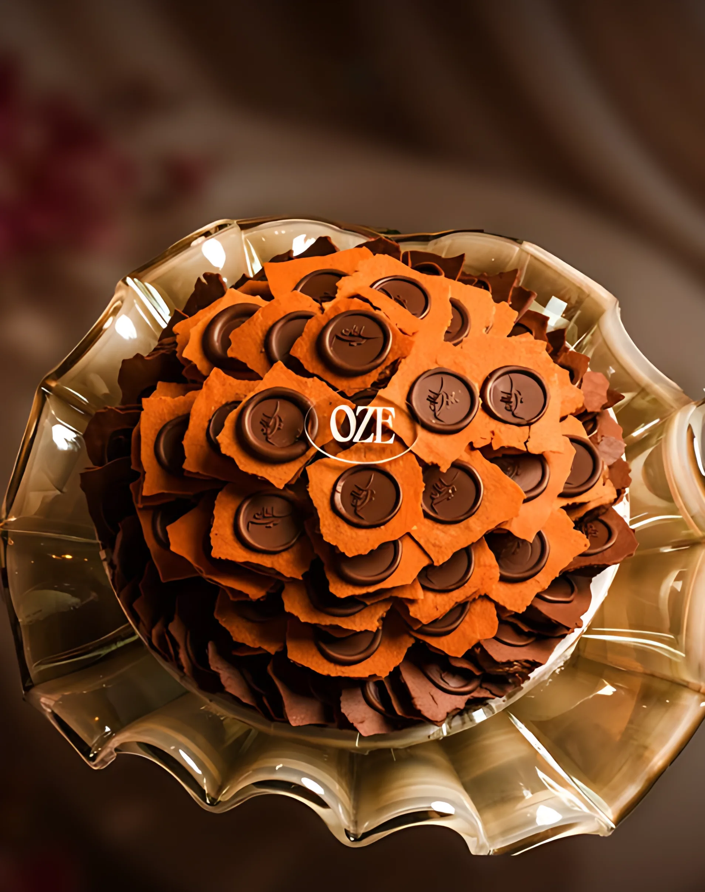
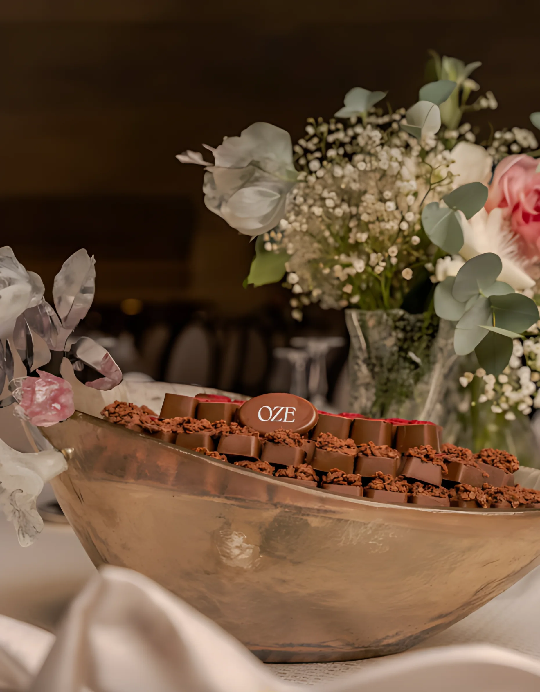
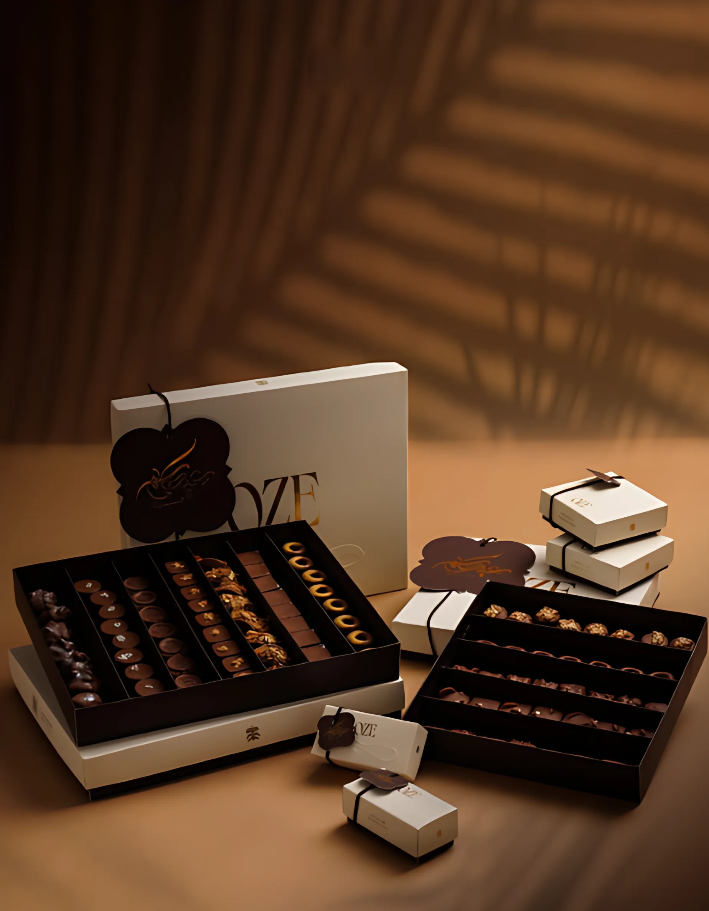

# OZE — Premium Swiss Chocolate, Riyadh

**Live site:** https://oze-chocolate.vercel.app
**Arabic version:** https://oze-chocolate.vercel.app/ar/

A one-page scroll site for OZE (أوز), a chocolate shop on King Abdullah Road, Al Mohammadiyyah, Riyadh.

## Signatures

| | |
|---|---|
|  |  |
| **The OZE Seal** | **The Gilded Dome** |
|  |  |
| **Cocoa Praline** | **Pistachio Kunafa** |
|  |  |
| **Rose Kunafa** | **The Crown** |

## Occasions

| | |
|---|---|
|  |  |
| **Weddings** | **Gifts** |

## Files

- `index.html`: English home page
- `ar/index.html`: Arabic (RTL) page
- `assets/`: styles, scripts, images, videos, fonts
- `robots.txt`, `sitemap.xml`: search engine crawl files
- `llms.txt`, `llms-full.txt`: information for AI assistants (English and Arabic)

## Run locally

```bash
python -m http.server 8000
```

Then open http://localhost:8000 (English) or http://localhost:8000/ar/ (Arabic).

## Deploy

Static site, no build step. Deployed on Vercel from the `main` branch.
